  
  
  
  

  
  
  

---

## 👋 About me

I'm **Utsha Basak**, a Computer Science graduate from **BRAC University** in Dhaka. I build complete products, from the database and API through to the web and Android clients, and I care about the parts most projects skip: CI, code scanning, tests, documentation and honest evaluation.

- 🛒 **Currently building:** [BookStoreBD](https://github.com/UtshaBasak/BookStoreBD), a live book marketplace for Bangladesh, and its [native Android app](https://github.com/UtshaBasak/BookStoreBD-Android).
- 🛡️ **Currently exploring:** detection engineering and SOC tooling with [Prohori](https://github.com/UtshaBasak/Prohori) (প্রহরী, "guard").
- 🧠 **Research interest:** multimodal deep learning. My [GNN + BERT music study](https://github.com/UtshaBasak/GNN-BERT-Music-Context-Understanding) covers 35,984 tracks across four public corpora.
- 🔐 **Things I like doing from scratch:** RSA, ECC and SHA-512 in JavaScript `BigInt`, journaling file systems in C, a 3D game in raw OpenGL.
- 📚 **Open-source recognition:** [BookStoreBD](https://hub.xerj.org/corpus/utshabasak--bookstorebd) was selected for the [XERJ Corpus Hub](https://hub.xerj.org/contributors/UtshaBasak), an open reference library that AI coding agents search before they write code. The account-closing commit (33 files, 2,060 lines) is included under the MIT license with attribution to me and the [repository](https://github.com/UtshaBasak/BookStoreBD).- 🤝 **Open to:** software engineering, security and ML roles, and to collaborating on open source.

---

## ⚡ At a glance

<picture>
  <source media="(prefers-color-scheme: dark)" srcset="https://raw.githubusercontent.com/UtshaBasak/UtshaBasak/output/stats-dark.svg" />
  <source media="(prefers-color-scheme: light)" srcset="https://raw.githubusercontent.com/UtshaBasak/UtshaBasak/output/stats-light.svg" />
  
</picture>
<picture>
  <source media="(prefers-color-scheme: dark)" srcset="https://raw.githubusercontent.com/UtshaBasak/UtshaBasak/output/languages-dark.svg" />
  <source media="(prefers-color-scheme: light)" srcset="https://raw.githubusercontent.com/UtshaBasak/UtshaBasak/output/languages-light.svg" />
  
</picture>

<picture>
  <source media="(prefers-color-scheme: dark)" srcset="https://streak-stats.demolab.com?user=UtshaBasak&theme=dark&background=0D1117&border=30363D&ring=38BDF8&fire=FF3B3B&currStreakLabel=38BDF8&border_radius=10" />
  <source media="(prefers-color-scheme: light)" srcset="https://streak-stats.demolab.com?user=UtshaBasak&theme=default&border=D0D7DE&ring=0969DA&fire=DC2626&currStreakLabel=0969DA&border_radius=10" />
  
</picture>

<picture>
  <source media="(prefers-color-scheme: dark)" srcset="https://raw.githubusercontent.com/UtshaBasak/UtshaBasak/output/activity-dark.svg" />
  <source media="(prefers-color-scheme: light)" srcset="https://raw.githubusercontent.com/UtshaBasak/UtshaBasak/output/activity-light.svg" />
  
</picture>

---

## 🛠️ Tech stack

### Languages

### Frontend & Mobile

### Backend & Databases

### Machine Learning & Data

### DevOps, Cloud & Tools

### Libraries & practices behind my projects

---

## 🚀 Featured projects

<table>
<tr>
<td width="50%" valign="top">

### 📚 [BookStoreBD](https://github.com/UtshaBasak/BookStoreBD)

A full-stack marketplace for new and second-hand books in Bangladesh. Role-based access (admin / seller / buyer), Bangla–English and voice search, real-time buyer–seller chat, order tracking, a wanted board, reviews and admin analytics.

🌐 [**Live site**](https://bookstorebd-loum.onrender.com)

</td>
<td width="50%" valign="top">

### 📱 [BookStoreBD for Android](https://github.com/UtshaBasak/BookStoreBD-Android)

The native Android client for BookStoreBD. It shares accounts, carts and orders with the website, and adds offline-friendly browsing, secure sign-in, dark mode and full Bangla support. Clean architecture with MVVM.

📦 [**Download the APK**](https://github.com/UtshaBasak/BookStoreBD-Android/releases/latest)

</td>
</tr>
<tr>
<td width="50%" valign="top">

### 🛡️ [Prohori](https://github.com/UtshaBasak/Prohori)

A laptop-sized mini-SOC: from raw logs to detections, enriched incidents and analyst-ready reports, with MITRE ATT&CK mapping, honest ML evaluation and a streaming pipeline. Parses `auth.log`, nginx/Apache and JSON Lines logs today.

</td>
<td width="50%" valign="top">

### 🎵 [GNN + BERT Music Context Understanding](https://github.com/UtshaBasak/GNN-BERT-Music-Context-Understanding)

A hybrid graph neural network and BERT system for tagging, genre, emotion and cross-modal retrieval across 35,984 tracks. It measures caption-to-label leakage (a 53% inflation) and reports only differences that clear a quantified measurement floor.

</td>
</tr>
<tr>
<td width="50%" valign="top">

### 🏠 [UrbanNest](https://github.com/UtshaBasak/UrbanNest)

A full-stack property rental platform that connects owners with tenants. Browse and compare homes, request bookings, leave reviews, rate owners and tenants, and manage everything from role-based dashboards, behind Helmet, rate limiting and request validation.

</td>
<td width="50%" valign="top">

### 🔐 [UrbanNest Secure](https://github.com/UtshaBasak/UrbanNest_Secure)

The security-first edition of UrbanNest: every piece of personal data is encrypted before it reaches the database. RSA, ECC (ECIES), SHA-512 and CBC-MAC are written from scratch with JavaScript `BigInt`, with no crypto library.

</td>
</tr>
</table>

<b>📂 More projects</b> (click to expand)

 

| Project | What it is | Stack | Clones |
| --- | --- | --- | --- |
| 💾 [VSFS](https://github.com/UtshaBasak/CSE321_VSFS) | Journaling file system in C: a write-ahead journal makes file creation crash-atomic, and an `fsck`-style validator proves the image is sound | C, Make |  |
| 🩸 [Blood Donation Camp](https://github.com/UtshaBasak/Blood-Donation-Camp) | Blood bank management system linking donors, recipients and branch banks across Dhaka, with an auditable stock ledger | Django, MySQL |  |
| 💳 [Loan Approval Prediction](https://github.com/UtshaBasak/CSE422_Project) | Logistic regression, KNN and MLP compared on 45,000 imbalanced loan applications using ROC AUC and per-class metrics | scikit-learn, Seaborn |  |
| 🏎️ [EndlessDriver](https://github.com/UtshaBasak/EndlessDriver) | 3D endless lane-racing game drawn entirely with raw OpenGL primitives: turbo, two camera views, four weather moods | Python, PyOpenGL, GLUT |  |
| 🏥 [SmartCity Healthcare Network](https://github.com/UtshaBasak/SmartCity) | Enterprise network for a city healthcare system: VLSM, DHCP, DNS, static and dynamic routing, automatic failover | Cisco Packet Tracer |  |
| 🗂️ [SimpleFS](https://github.com/UtshaBasak/SimpleFS) | A simple inode-based file system on a binary disk image | C |  |
| 📗 [MernBookstore](https://github.com/UtshaBasak/MernBookstore) | The first MERN version of BookStoreBD, forked from [Prottasha0212/MernBookstore](https://github.com/Prottasha0212/MernBookstore): authentication, role-based access (admin / seller / buyer), cart and wishlist, order tracking, real-time chat and protected routes | MERN, Socket.IO, Tailwind |  |

---

## 📈 Project impact

<picture>
  <source media="(prefers-color-scheme: dark)" srcset="https://raw.githubusercontent.com/UtshaBasak/UtshaBasak/output/projects-dark.svg" />
  <source media="(prefers-color-scheme: light)" srcset="https://raw.githubusercontent.com/UtshaBasak/UtshaBasak/output/projects-light.svg" />
  
</picture>

Every number on this page is rebuilt every six hours by <a href="https://github.com/UtshaBasak/UtshaBasak/actions/workflows/profile.yml">a GitHub Actions workflow</a>. GitHub keeps traffic for 14 days only, so clones and views are counted from the date shown.

---

## 🐍 Contribution snake

<picture>
  <source media="(prefers-color-scheme: dark)" srcset="https://raw.githubusercontent.com/UtshaBasak/UtshaBasak/output/snake-dark.svg" />
  <source media="(prefers-color-scheme: light)" srcset="https://raw.githubusercontent.com/UtshaBasak/UtshaBasak/output/snake-light.svg" />
  
</picture>

---

## 🎓 Education

<picture>
  <source media="(prefers-color-scheme: dark)" srcset="https://raw.githubusercontent.com/UtshaBasak/UtshaBasak/output/education-dark.svg" />
  <source media="(prefers-color-scheme: light)" srcset="https://raw.githubusercontent.com/UtshaBasak/UtshaBasak/output/education-light.svg" />
  
</picture>

---

## 📫 Let's connect

⭐ If you find any of my projects useful, a star is always appreciated.

